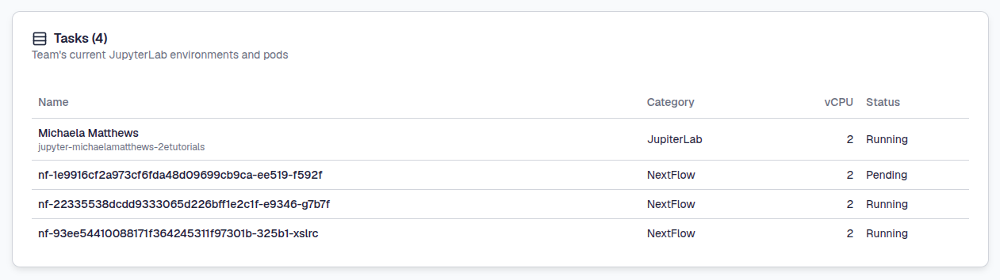
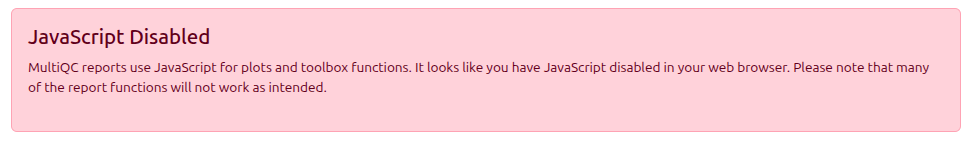
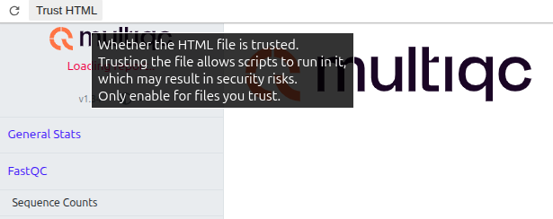
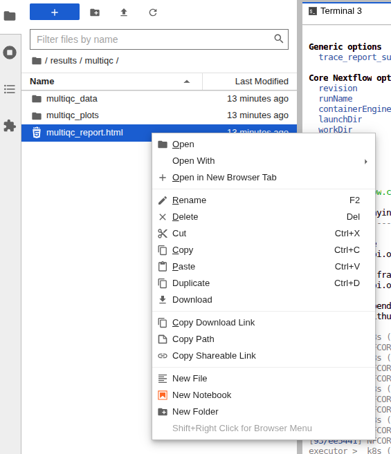

# **Using Nextflow**

---

[**Nextflow**](https://nextflow.io) is a workflow framework that allows you to easily create and use computationally heavy microbial bioinformatics pipelines. Nextflow is a “Domain Specific Language” (DSL) built upon [**Groovy**](https://groovy-lang.org/). Some terms that will be used throughout this page:

* **processes**: the task to be run e.g command/script(s)
* **channels**: asynchronous queues of data
* **workflows/pipelines**: a set of processes and channels
* **modules**: ready to use processes

Nextflow allows users to easily join together different **processes** and scripting languages (Bash, Perl, Ruby, Python etc.). Processes are isolated from each other and executed independently but can interact via input and output data **channels**.

For further information on how to create modules and pipelines please see the [**nextflow documentation**](https://www.nextflow.io/docs/latest/index.html). 

This page will guide you through the basics of Nextflow with the following sections:

+ [**Why should you use Nextflow ?**](4.1.6.nextflow.md#why-should-you-use-nextflow)
+ [**How to start ?**](4.1.6.nextflow.md#how-to-start)
+ [**Using nf-core**](4.1.6.nextflow.md#using-nf-core)
+ [**Run Nextflow locally with Mamba**](4.1.6.nextflow.md#run-nextflow-locally-with-mamba)

---

## **Why should you use Nextflow ?**

* **Accessibility**: Nextflow makes bioinformatics accessible for everyone. Using a Nextflow pipeline, instead of performing multiple computational steps manually, you can run a single nextflow command to easily go from raw sequence reads to multiple outputs.

* **Continuity**: Checkpoints within Nextflow pipelines allow you to resume your workflow if its stops.

* **Reproducibility**: Nextflow supports the use of containers.

* **Parrallisation**: You can scale -up analysis easily, running a large number of samples a the same time. Speeding up analysis time ! 

---

## **How to start?**

You'll find an up-to-date, stable version pre-installed in your JupyterLab environment and, more importantly, pre-configured to take advantage of our scalable Kubernetes infrastructure. You can access Nextflow via the terminal.

For more information on how to create a JupyterLab environment and use the terminal see our [**JupyterLab environments**](4.1.1.jupyterLab-envs.md) and [**Terminal**](4.1.3.terminal.md) pages.

Once you have your terminal open you can access Nextflow as follows:

```
nextflow -v
```
You will see the currently installed version:
```
nextflow version 25.10.5.12056
```

!!! tip
    Your version may be newer than the one above. You should use this pre-installed version rather than downloading another version.

### **CLIMB Nextflow config defaults**

We have tried to make it as easy as possible to use Nextflow on CLIMB, and to make full use of available resources via our Kubernetes infrastructure. Out-of-the box, we set a number of configuration defaults.

- Nextflow home is set to `/shared/team/nxf_work/$JUPYTERHUB_USER`
- WorkDir is set to `/shared/team/nxf_work/$JUPYTERHUB_USER/work`
- Executor is set to `k8s` (plus some supporting config)
- `/shared/team` and `/shared/public` (read only) are mounted as PVCs to all Nextflow pods
- A K8s ServiceUser is pre-mounted (no credentials setup required)
- S3 bucket path-style access is enabled, with `s3.climb.ac.uk` set as the endpoint
- S3 keys have also been injected from Bryn

### **How does Nextflow work with CLIMBs infrastructure ?**

The CLIMB infrastructure utilises [**Kubernetes**](https://kubernetes.io/) also known as K8s, an open-source system for automating deployment, scaling, and management of containerised applications.

Nextflow has built in support for Kubernetes which allows for the execution of workflows in Kubernetes clusters.

Nextflow -> Kubernetes executor -> Kubernetes pod(s) created to run containers for each process in the workflow

**TLDR**: don't worry about it. Nextflow and Kubernetes run everything for you !

Each time a JupyterLab environment is launched, a pod will be created. Pods are also used when launching nextflow pipelines.

Once you have launched an environment you can track which processes are running through [**`kubectl`**](https://kubernetes.io/docs/reference/kubectl/), the Kubernetes command line tool. It's pre-installed for you and pre-configured with credentials that map to your team. These credentials mean an isolated part of CLIMBs system is used specifically for your team. This means you can **track all JupyterLab environment and Nextflow pods currently created**.

!!! warning
    When a teams vCPUs are maxed out, you will not be able to have any new pods for JupyterLab environments or Nextflow launched.

The easiest way to use Nextflow is to use pre-exiting pipelines such as those from [**nf-core**](https://nf-co.re/).

---

## **Using nf-core**

**nf-core** is a community-curated set of analysis [**pipelines**](https://nf-co.re/pipelines/) that use Nextflow. 

We'll try running `nf-core/demo` as an example, to demonstrate some features of how Nextflow is configured to work on CLIMB.

This pipeline does basic quality control and processing of genomic sequencing data with the following tools:

* [**fastQC**](https://github.com/s-andrews/fastqc) – quality control checks
* [**seqtk**](https://github.com/lh3/seqtk) – adapter and quality trimming
* [**multiQC**](https://github.com/multiqc/multiqc) – combines QC metrics into an interactive report

We'll be using the flag `-profile test`, which includes links to a test dataset provided with Nextflow. Under `-profile` we will also add `docker` as the container used to run the pipeline. As a result, we'll only need to specify the `--outdir` flag for now. To run the pipeline use the following command:

```
nextflow run nf-core/demo -profile test,docker --outdir results
```

!!! info
    If there is a suggestion to update the version, ignore this !

As the pipeline starts, multiple jobs will be run and appear:

```
 N E X T F L O W   ~  version 25.10.5

Launching `https://github.com/nf-core/demo` [desperate_celsius] DSL2 - revision: 32893afef8 [master]


------------------------------------------------------
                                        ,--./,-.
        ___     __   __   __   ___     /,-._.--~'
  |\ | |__  __ /  ` /  \ |__) |__         }  {
  | \| |       \__, \__/ |  \ |___     \`-._,-`-,
                                        `._,._,'
  nf-core/demo 1.2.0
------------------------------------------------------

Input/output options
  input                     : https://raw.githubusercontent.com/nf-core/test-datasets/viralrecon/samplesheet/samplesheet_test_illumina_amplicon.csv
  outdir                    : results

Institutional config options
  config_profile_name       : Test profile
  config_profile_description: Minimal test dataset to check pipeline function

Generic options
  trace_report_suffix       : 2026-08-13_10-33-55

Core Nextflow options
  revision                  : master
  runName                   : desperate_celsius
  containerEngine           : docker
  launchDir                 : /home/jovyan
  workDir                   : /shared/team/nxf_work/michaelamatthews.tutorials/work
  projectDir                : /shared/team/nxf_work/michaelamatthews.tutorials/assets/nf-core/demo
  userName                  : jovyan
  profile                   : test,docker
  configFiles               : /shared/team/nxf_work/michaelamatthews.tutorials/assets/nf-core/demo/nextflow.config, /etc/nextflow.config

!! Only displaying parameters that differ from the pipeline defaults !!
------------------------------------------------------

* The pipeline
    https://doi.org/10.5281/zenodo.12192442

* The nf-core framework
    https://doi.org/10.1038/s41587-020-0439-x

* Software dependencies
    https://github.com/nf-core/demo/blob/master/CITATIONS.md

executor >  k8s (7)
[97/ef39b7] NFCORE_DEMO:DEMO:FASTQC (SAMPLE3_SE)     | 0 of 3
[0e/5bcae3] NFCORE_DEMO:DEMO:SEQTK_TRIM (SAMPLE3_SE) | 0 of 3
[cf/785b87] NFCORE_DEMO:DEMO:COWPY                   | 0 of 1
[-        ] NFCORE_DEMO:DEMO:MULTIQC                 -

```

Here we can see the pipeline is executing interdependent process in parallel, using the Kubernetes executor. This means rather than having everything running inside your JupyterLab environment container directly, new Kubernetes pods are being created on the fly and spinning up containers for each process.

!!! tip
    You may see one or more lines of `WARN: K8s Job [nf-jobidentifier] does not have a pod - Not yet scheduled?` appear but you can **ignore this** as it just means the pipeline needs to wait until resource is available to create the pods. Remember, any vCPUs not used for the JupyterLab environment itself are used for Nextflow.

To track all the Nextflow pods currently created just open another terminal tab and run the following `kubectl` command:

```
kubectl get pods
```

You will see all running and pods being created as follows:

```
NAME                                              READY   STATUS              RESTARTS   AGE
jupyter-michaelamatthews-2etutorials              1/1     Running             0          9d
nf-cf785b873400d3b7f93083a3f36f4de4-eeeee-5p847   0/1     ContainerCreating   0          0s
nf-22335538dcdd9333065d226bff1e2c1f-e9346-g7b7f   0/1     ContainerCreating   0          0s
nf-93ee54410088171f364245311f97301b-325b1-xslrc   0/1     ContainerCreating   0          0s
nf-1e9916cf2a973cf6fda48d09699cb9ca-ee519-f592f   0/1     ContainerCreating   0          0s
```

You'll see your JupyterLab environment (**jupyter-username-team**) and all the pods that are being created/currently running workflow process containers. The **STATUS** of each of the pods will change as they execute and then disappear.

Back on bryn, the **compute usage section** will also update with the same information:

 

The test data for this pipeline only contains 3 samples so it will only take only a few minutes to run.

!!! tip

    If your pipeline fails for no apparent reason, you can add the `--resume` flag to the end of the original command to continue where it stopped.

    However, if it still provides errors after resuming, do check your input and intermediate data files. If you still cannot continue your pipeline after checking, please do [**contact us**](mailto:climb@quadram.ac.uk) with as much information as possible for troubleshooting.


Once the workflow has finished the terminal will update like the following:

```
 N E X T F L O W   ~  version 25.10.5

Launching `https://github.com/nf-core/demo` [desperate_celsius] DSL2 - revision: 32893afef8 [master]


------------------------------------------------------
                                        ,--./,-.
        ___     __   __   __   ___     /,-._.--~'
  |\ | |__  __ /  ` /  \ |__) |__         }  {
  | \| |       \__, \__/ |  \ |___     \`-._,-`-,
                                        `._,._,'
  nf-core/demo 1.2.0
------------------------------------------------------

Input/output options
  input                     : https://raw.githubusercontent.com/nf-core/test-datasets/viralrecon/samplesheet/samplesheet_test_illumina_amplicon.csv
  outdir                    : results

Institutional config options
  config_profile_name       : Test profile
  config_profile_description: Minimal test dataset to check pipeline function

Generic options
  trace_report_suffix       : 2026-08-13_10-33-55

Core Nextflow options
  revision                  : master
  runName                   : desperate_celsius
  containerEngine           : docker
  launchDir                 : /home/jovyan
  workDir                   : /shared/team/nxf_work/michaelamatthews.tutorials/work
  projectDir                : /shared/team/nxf_work/michaelamatthews.tutorials/assets/nf-core/demo
  userName                  : jovyan
  profile                   : test,docker
  configFiles               : /shared/team/nxf_work/michaelamatthews.tutorials/assets/nf-core/demo/nextflow.config, /etc/nextflow.config

!! Only displaying parameters that differ from the pipeline defaults !!
------------------------------------------------------

* The pipeline
    https://doi.org/10.5281/zenodo.12192442

* The nf-core framework
    https://doi.org/10.1038/s41587-020-0439-x

* Software dependencies
    https://github.com/nf-core/demo/blob/master/CITATIONS.md

executor >  k8s (8)
[97/ef39b7] NFCORE_DEMO:DEMO:FASTQC (SAMPLE3_SE)     | 3 of 3 ✔
[0e/5bcae3] NFCORE_DEMO:DEMO:SEQTK_TRIM (SAMPLE3_SE) | 3 of 3 ✔
[cf/785b87] NFCORE_DEMO:DEMO:COWPY                   | 1 of 1 ✔
[29/032591] NFCORE_DEMO:DEMO:MULTIQC (demo)          | 1 of 1 ✔
-[nf-core/demo] Pipeline completed successfully-
Completed at: 13-Aug-2026 10:35:37
Duration    : 1m 39s
CPU hours   : (a few seconds)
Succeeded   : 8
```

In a separate terminal run the above command again:

```
kubectl get pods
```

You will see the following:

```
NAME                                   READY   STATUS    RESTARTS   AGE
jupyter-michaelamatthews-2etutorials   1/1     Running   0          9d
```

Now you're back to just your JupyterLab environment. You may also see those belonging to others in your team.

### **Where did my output data go?**

We specified `results` as the output dir and you'll see the directory in the file browser on the left hand side of the JupyterLab interface. The `results` directory will contain the following output files:

```
results/
├── fastqc/          # Raw FastQC reports for each sample
├── fq/              # Trimmed FastQ files
├── multiqc/         # Aggregated QC report
│   └── multiqc_report.html
└── pipeline_info/   # Execution logs and metadata
```

Take a look within all the different directories inside your file browser. Try double clicking on the various HTML, YAML and CSV files here and you'll see that they open in new tabs for immediate reading.

The main results can be seen in the **MultiQC report file**.

When opening HTML files such as `multiqc_report.html` within the JupyterLab environment, JavaScript is disabled in the tab by default. You may see a warning within the report file as follows:

 

Do check your browser settings to make sure you have Javascript enabled and also select Trust HTML at the top left of the report:

 

 

This may take some time to load so please be patient. Alternatively, right click the file and select `Open in New Browser Tab` from the context window to see the full report.

 

If this still doesn’t work, you can download the file locally and open it in a browser.


### **Where are Nextflow assets and temporary/intermediate (workdir) outputs stored ?**

By default, the CLIMB Nextflow config sets Nextflow 'home' to `/shared/team/nxf_work/$JUPYTERHUB_USER.team`. You can view these files using the following command:

```
 ls /shared/team/nxf_work/michaelamatthews.tutorials/
```

You'll see a number of subdirectories exist at that location:

```
assets  framework  plugins  secrets  tmp  work
```
This includes directories such as `assets`, which will contain the demo workflow we just used along with any other pipelines you run, and `work` where the intermediate outputs are located.

---

## **Nextflow parser Changes**

In Nextflow version `v26.04` the default language parser was changed to v2, a full breakdown of what this means for your pipelines [can be found on the Nextflow website](https://docs.seqera.io/nextflow/strict-syntax?utm_campaign=41211479-Q2-Apr-2026-Product-Summit-26.1-Release&utm_source=blog).

If you are using modern, well-maintained pipelines from nf-core, then this parser change should not impact you. However, if you are running older pipelines which have not been actively updated, you may experience errors like the following:

```
Error nextflow.config:168:14: Unexpected input: '('
│ 168 | def check_max(obj, type) {
╰     |              ^


ERROR ~ Config parsing failed
```

Note that this error is purely illustrative, the error will entirely depend on the syntax that the v2 parser considers invalid.

In this case, you should try rerunning the pipeline with the command `nextflow-legacy` instead of `nextflow` which will enable the more permissive `v1` parser, like this:

```
nextflow-legacy run nf-core/demo -profile test,docker --outdir results
```

## **Run NextFlow locally with Mamba**

When working with limited computing resources or tasks that don't require additional cores, launching new ones might not be the most efficient choice. In such cases, NextFlow offers a solution by allowing you to utilise the cores already assigned to your notebook for execution.

To achieve this, NextFlow provides the option to specify the `profile` to **mamba** and set the `process.executor` to **local**. By doing so, you can optimise resource usage and minimise unnecessary overhead.

To run NextFlow **with Mamba** for nf-core pipelines, run the following commands:

```
nextflow run <your_nfcore_pipeline.nf> -profile mamba -process.executor=local
```
Replace `<your_nfcore_pipeline.nf>` with the filename of the nf-core pipeline you want to execute. The options `-profile` and `-process.executor` should be specified to ensure proper configuration.

If Mamba encounters issues with older pipelines, you can use the `-profile conda` option instead. However, note that this may be slower:

```
nextflow run <your_nfcore_pipeline.nf> -profile conda -process.executor=local
```

---

# **What is next ?**

Once you know some Nextflow basics, you can also try using the [**jupyter notebooks**](4.1.4.jupyter-notebook.md) and [**RStudio**](4.1.5.rstudio.md).