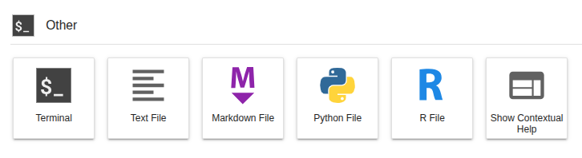
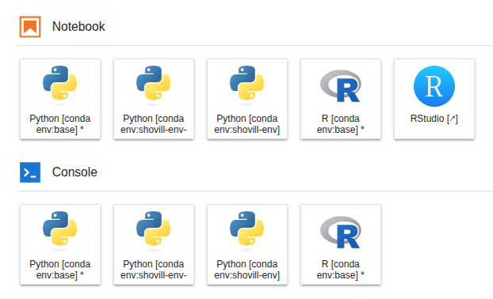
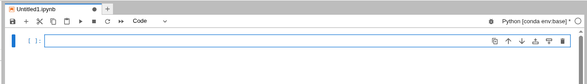
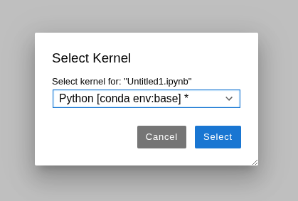
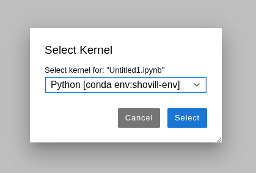
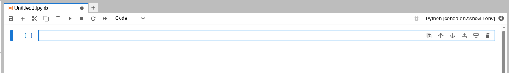

# **Using conda**

---

[**conda**](https://docs.conda.io/en/latest/) is a package and environment management system that helps you to find and install software without having to worry about dependency issues.

For more information on conda usage see the [**conda documentation**](https://docs.conda.io/projects/conda/en/latest/user-guide/tasks/manage-environments.html)

However, please note that using conda via a JupyterLab environment will be a little different compared to using it locally.

This page will guide you through how to install software using conda with the following sections:

+ [**conda terminology**](4.1.7.conda.md#conda-terminology)
+ [**Accessing conda**](4.1.7.conda.md#accessing-conda)
+ [**conda configurations**](4.1.7.conda.md#conda-configurations)
+ [**Creating a new conda environment**](4.1.7.conda.md#creating-a-new-conda-environment)
+ [**Using YAML files to build conda environments**](4.1.7.conda.md#using-yaml-files-to-build-conda-environments)
+ [**Using conda environments in Jupyter notebooks**](4.1.7.conda.md#using-conda-environments-in-jupyter-notebooks)
+ [**Creating a new mamba environment**](4.1.7.conda.md#creating-a-new-mamba-environment)

---

## **conda terminology**

There are a few different terms which we use throughout this page: 

+ **conda** - the package manager
+ **conda packages** - compressed files with everything needed to run software
+ **channels** - repositories for conda to look for packages
+ **bioconda** - channel for bioinformatics software
+ **conda-forge** - channel for bioinformatics software
+ **conda environment** - a collection of conda packages and dependencies

---

## **Accessing conda**

conda is already installed and ready to use within JupyterLab environments. To access conda, you need to open a terminal.

Select `File -> New -> terminal`, or you can launch a terminal session from the Other launcher within the main work area:



You'll get a new terminal tab in the activity bar, and will find yourself in a bash shell.

Remember, there is **no sudo access** via the terminal in JupyterHub and using conda will be a little different compared to using it locally.

conda can be found using the following command:

```
conda info --envs

```

Here you can see that the base conda environment is installed at `/opt/conda`. However, **you cannot install new software to the base conda environment**.

Since we are running everything inside a JupyterLab environment (a container), any changes made to this part of the filesystem will not be retained once the container is stopped and restarted. This is different to your home dir and team/public share storage which persist.

To avoid any issues, the base environment is configured to be **read only**. If you try to install to the base conda environment you will see the following error:
```
EnvironmentNotWritableError: The current user does not have write permissions to the target environment.
environment location: /opt/conda
uid: 1000
gid: 100
```

To install new software, you will need to make a **new conda environment**. You can find examples on how to create conda environments below.

---

## **conda configurations**

When you first launch a JupyterLab environment, a default `.condarc` (Conda Runtime Configuration file) is generated at `/opt/conda`.

When you create any new conda environments, they will automatically be saved to your **team share storage** at `/shared/team/conda/$JUPYTERHUB_USER`.

This configuration is due to your home directory being relatively small (20GB) compared to your team share (500GB+) so it is better to use a larger mount. In addition, it is easy to share conda environments with your team members.

As part of this configuration, by default, whenever you create a new environment, `ipykernel` will also be installed which will allow you to use the environment with **Jupyter notebooks**. It will appear on the launcher and be available to select within the python notebooks interface. You can still use the environment as usual within a terminal.

---

## **Creating a new conda environment**

Conda installs software from channels with a lot of bioinformatics software found in the bioconda channel. The bioconda channel is also dependent on the conda-forge channel. You already have access to these channels and can see them using the following command:

```
conda config --show channels

```
You should see that the two channels are already available for you:

```
channels:
  - conda-forge
  - bioconda

```

We will create a new environment and use these channels to install the bacterial genome assembler [**Shovill**](https://github.com/tseemann/shovill) for short-read data.

You can search which **versions** of shovill are available to install:

```
conda search shovill
```

Please note this may take a few minutes to run, so be patient.

```
Loading channels: done
# Name                       Version           Build  Channel             
shovill                        0.7.1      pl5.22.0_0  bioconda            
shovill                        0.7.1      pl5.22.0_1  bioconda            
shovill                        0.7.1      pl5.22.0_2  bioconda            
shovill                        0.8.0      pl5.22.0_0  bioconda            
shovill                        0.9.0               1  bioconda            
shovill                        0.9.0      pl5.22.0_0  bioconda            
shovill                        1.0.0               0  bioconda            
shovill                        1.0.1               0  bioconda            
shovill                        1.0.4               0  bioconda            
shovill                        1.0.4               1  bioconda            
shovill                        1.0.9               0  bioconda            
shovill                        1.1.0               0  bioconda            
shovill                        1.1.0      hdfd78af_1  bioconda            
shovill                        1.1.0      hdfd78af_2  bioconda            
shovill                        1.4.1      hdfd78af_0  bioconda            
shovill                        1.4.2      hdfd78af_0  bioconda      

```

Here you can see all the available versions to install. We will use the most up to date version available.

We will create a new environment named `shovill-env` containing shovill v1.4.2. You will need to confirm the install with `y` to proceed:

```
conda create --name shovill-env shovill=1.4.2
```
!!! tip
    If  you see the error `CondaValueError: prefix already exists`, then there is already a conda environment using the same name, so you will need to pick a different name !

When conda has finished setting up the environment, you can run the following command to **activate** the environment:

```
conda activate shovill-env
```
The prompt will update to show that the environment is active like so:

```
(shovill-env) jovyan:~$
```
You can then run the following to check Shovill has installed correctly:

```
shovill --version
```
This will report the version of Shovill you installed:

```
shovill 1.4.2
```

To **list** which packages and dependencies are installed in your `shovill-env` environment you can run the following command:

```
conda list
```
This will provide you with a long list including the versions, build and associated channel is was installed from.

To install a new software package **within your currently activated environment** you can run the following command:

```
conda install $packageName
```

To **deactivate** your current conda environment you can run the following command:

```
conda deactivate
```

To see a **list of all environments** you can run the following command:

```
conda info --envs
```

It will look as follows with the location as `/shared/team/conda/$JUPYTERHUB_USER/env_name`:

```
# conda environments:
#
# * -> active
# + -> frozen
base                     /opt/conda
shovill-env             /shared/team/conda/michaelamatthews.tutorials/shovill-env
```

This will update as you and your team create more conda environments.

To **delete** an environment you can use the following command, you will need to confirm the deletion with `y` to proceed:

```
conda env remove -n shovill-env
```

A full list of **conda commands** can be found using the conda help command:
```
conda --help
```
You will see similar output as follows:

```
usage: conda [-h] [-v] [--no-plugins] [-V] COMMAND ...

conda is a tool for managing and deploying applications, environments and packages.

options:
-h, --help      Show this help message and exit.
-v, --verbose   Can be used multiple times. Once for detailed output, twice for INFO logging, thrice for DEBUG logging, four times for TRACE logging.
--no-plugins    Disable all plugins that are not built into conda.
-V, --version   Show the conda version number and exit.

commands:
The following built-in and plugins subcommands are available.

COMMAND
activate        Activate a conda environment.
check           Display a health report for your environment (alias for doctor).
clean           Remove unused packages and caches.
commands        List all available conda subcommands (including those from plugins). Generally only used by tab-completion.
compare         Compare packages between conda environments.
config          Modify configuration values in .condarc.
create          Create a new conda environment from a list of specified packages.
deactivate      Deactivate the current active conda environment.
doctor          Display a health report for your environment.
env             Create and manage conda environments.
export          Export a given environment
info            Display information about current conda install.
init            Initialize conda for shell interaction.
install         Install a list of packages into a specified conda environment.
list            List installed packages in a conda environment.
menuinst        A subcommand for installing and removing shortcuts via menuinst.
notices         Retrieve latest channel notifications.
package         Create low-level conda packages. (EXPERIMENTAL)
remove (uninstall)
                Remove a list of packages from a specified conda environment.
rename          Rename an existing environment.
repoquery       Advanced search for repodata.
run             Run an executable in a conda environment.
search          Search for packages and display associated information using the MatchSpec format.
update (upgrade) Update conda packages to the latest compatible version.
```

## **Using YAML files to build conda environments**

You can also create conda environments using YAML files e.g `environment.yml`. This is great if you want to recreate an conda environment with the exact same software and dependency versions elsewhere.

You can **export an existing active conda environment** into a YAML file:

```
conda activate shovill-env

conda env export > environment.yml
```

This file will contain the name of the environment, the channel and dependencies required to install like so:

```
name: shovill-env
channels:
  - conda-forge
  - bioconda
dependencies:
  - _openmp_mutex=4.5=20_gnu
  - alsa-lib=1.2.16.1=hb03c661_0
  - asttokens=3.0.1=pyhd8ed1ab_0
  - bwa=0.7.19=h577a1d6_1
  - bzip2=1.0.8=hda65f42_9
  - c-ares=1.34.6=hb03c661_0
  - ca-certificates=2026.6.17=hbd8a1cb_0
  - cairo=1.18.4=he90730b_1
  - comm=0.2.3=pyhe01879c_0
  - csvtk=0.37.0=ha770c72_1
  - debugpy=1.8.21=py310h25320af_0
  - decorator=5.3.1=pyhd8ed1ab_0
  - exceptiongroup=1.3.1=pyhd8ed1ab_0
  - executing=2.2.1=pyhd8ed1ab_0
  - flash=1.2.11=hadc24fc_2
  - font-ttf-dejavu-sans-mono=2.37=hab24e00_0
  - font-ttf-inconsolata=3.000=h77eed37_0
  - font-ttf-source-code-pro=2.038=h77eed37_0
  - font-ttf-ubuntu=0.83=h77eed37_3
  - fontconfig=2.18.1=h27c8c51_0
  - fonts-conda-ecosystem=1=0
  - fonts-conda-forge=1=hc364b38_1
  - giflib=5.2.2=hd590300_0
  - graphite2=1.3.15=hecca717_0
  - harfbuzz=14.2.1=h6083320_0
  - htslib=1.23.1=h633afcb_0
  - icu=78.3=h33c6efd_0
  - ipykernel=7.3.0=pyha191276_0
  - ipython=8.37.0=pyh8f84b5b_0
  - jedi=0.19.2=pyhd8ed1ab_1
  - jupyter_client=8.9.1=pyhcf101f3_0
  - jupyter_core=5.9.1=pyhc90fa1f_0
  - kernel-headers_linux-64=3.10.0=he073ed8_18
  - keyutils=1.6.3=hb9d3cd8_0
  - kmc=3.2.4=h5ca1c30_4
  - krb5=1.22.2=ha1258a1_0
  - lcms2=2.19.1=h0c24ade_1
  - ld_impl_linux-64=2.45.1=default_hbd61a6d_102
  - lerc=4.1.0=hdb68285_0
  - libcups=2.3.3=h7a8fb5f_6
  - libcurl=8.20.0=hcf29cc6_0
  - libdeflate=1.25=h17f619e_0
  - libedit=3.1.20250104=pl5321h7949ede_0
  - libev=4.33=hd590300_2
  - libexpat=2.8.1=hecca717_1
  - libffi=3.5.2=h3435931_0
  - libfreetype=2.14.3=ha770c72_0
  - libfreetype6=2.14.3=h73754d4_0
  - libgcc=15.2.0=he0feb66_19
  - libgcc-ng=15.2.0=h69a702a_19
  - libglib=2.88.1=h0d30a3d_2
  - libgomp=15.2.0=he0feb66_19
  - libiconv=1.18=h3b78370_2
  - libjpeg-turbo=3.1.4.1=hb03c661_0
  - liblzma=5.8.3=hb03c661_0
  - libnghttp2=1.68.1=h877daf1_0
  - libnsl=2.0.1=hb9d3cd8_1
  - libpng=1.6.58=h421ea60_0
  - libsodium=1.0.22=h280c20c_1
  - libsqlite=3.53.2=h0c1763c_0
  - libssh2=1.11.1=hcf80075_0
  - libstdcxx=15.2.0=h934c35e_19
  - libstdcxx-ng=15.2.0=hdf11a46_19
  - libtiff=4.7.1=h9d88235_1
  - libuuid=2.42.2=h5347b49_0
  - libwebp-base=1.6.0=hd42ef1d_0
  - libxcb=1.17.0=h8a09558_0
  - libxcrypt=4.4.36=hd590300_1
  - libzlib=1.3.2=h25fd6f3_2
  - lighter=1.1.3=h077b44d_2
  - llvm-openmp=8.0.1=hc9558a2_0
  - matplotlib-inline=0.2.2=pyhd8ed1ab_0
  - megahit=1.2.9=haf24da9_8
  - ncurses=6.6=hdb14827_0
  - nest-asyncio2=1.7.2=pyhcf101f3_0
  - openjdk=25.0.2=ha668962_0
  - openmp=8.0.1=0
  - openssl=3.6.3=h35e630c_0
  - packaging=26.2=pyhc364b38_0
  - parso=0.8.7=pyhcf101f3_0
  - pcre2=10.47=haa7fec5_0
  - perl=5.32.1=7_hd590300_perl5
  - perl-file-spec=3.48_01=pl5321hdfd78af_2
  - perl-findbin=1.54=pl5321hdfd78af_0
  - pexpect=4.9.0=pyhd8ed1ab_1
  - pickleshare=0.7.5=pyhd8ed1ab_1004
  - pigz=2.8=h421ea60_2
  - pilon=1.24=hdfd78af_0
  - pip=26.1.2=pyh8b19718_0
  - pixman=0.46.4=h54a6638_1
  - platformdirs=4.10.0=pyhcf101f3_0
  - prompt-toolkit=3.0.52=pyha770c72_0
  - psutil=7.2.2=py310h139afa4_0
  - pthread-stubs=0.4=hb9d3cd8_1002
  - ptyprocess=0.7.0=pyhd8ed1ab_1
  - pure_eval=0.2.3=pyhd8ed1ab_1
  - pygments=2.20.0=pyhd8ed1ab_0
  - python=3.10.20=h267e890_1_cpython
  - python-dateutil=2.9.0.post0=pyhe01879c_2
  - python_abi=3.10=8_cp310
  - pyzmq=27.1.0=py310ha71cbf4_3
  - readline=8.3=h853b02a_0
  - samclip=0.4.0=hdfd78af_1
  - samtools=1.23.1=ha83d96e_0
  - seqkit=2.13.0=he881be0_0
  - setuptools=82.0.1=pyh332efcf_0
  - shovill=1.4.2=hdfd78af_0
  - six=1.17.0=pyhe01879c_1
  - skesa=2.5.1=h077b44d_2
  - spades=3.15.5=h5fb382e_3
  - stack_data=0.6.3=pyhd8ed1ab_1
  - sysroot_linux-64=2.17=h0157908_18
  - tk=8.6.13=noxft_h366c992_103
  - tornado=6.5.7=py310h7c4b9e2_0
  - traitlets=5.15.1=pyhcf101f3_0
  - trimmomatic=0.40=hdfd78af_0
  - typing_extensions=4.15.0=pyhcf101f3_0
  - tzdata=2025c=hc9c84f9_1
  - velvet=1.2.10=h577a1d6_9
  - wcwidth=0.8.1=pyhd8ed1ab_0
  - wheel=0.47.0=pyhd8ed1ab_0
  - xorg-libice=1.1.2=hb9d3cd8_0
  - xorg-libsm=1.2.6=he73a12e_0
  - xorg-libx11=1.8.13=he1eb515_0
  - xorg-libxau=1.0.12=hb03c661_1
  - xorg-libxdmcp=1.1.5=hb03c661_1
  - xorg-libxext=1.3.7=hb03c661_0
  - xorg-libxfixes=6.0.2=hb03c661_0
  - xorg-libxi=1.8.3=hb03c661_0
  - xorg-libxrandr=1.5.5=hb03c661_0
  - xorg-libxrender=0.9.12=hb9d3cd8_0
  - xorg-libxt=1.3.1=hb9d3cd8_0
  - xorg-libxtst=1.2.5=hb9d3cd8_3
  - zeromq=4.3.5=h09e67af_11
  - zlib=1.3.2=h25fd6f3_2
  - zstd=1.5.7=hb78ec9c_6
prefix: /shared/team/conda/michaelamatthews.tutorials/shovill-env
```

The active environment can then be **deactivated** again:

```
conda deactivate
```

!!! tip
    Remember to change the **environment name** if an environment with the same name already exists where you wish to install the new environment.

To create a conda environment from this YAML file you can use the following command:

```
conda env create -f environment.yml
```

---

## **Using conda environments in Jupyter notebooks**

As described within the [**conda configuration**](4.1.7.conda.md#conda-configurations) section, all environments have `ipykernel` installed by default. This will allow you to use the environments with **Jupyter notebooks** or on the **Console**. 

Your environments will appear on the launcher:



And also be available to select within the python notebooks interface. Just select the kernel on the top right of the notebook:



Usually this will be "Python [conda env:root]" or "Python 3 (ipykernel)".

Use the drop down menu to choose the environment e.g **"Python [conda env:shovill-env]"**:





This will update the kernel on the top right of the notebook:



After changing the kernel, it's worth restarting the kernel and running your code cells again for the environment to be fully registered.

See our [**Jupyter notebook page**](4.1.4.jupyter-notebook.md) for more information on using JupyterLab notebooks.

---

## **Creating a new mamba environment**

[**Mamba**](https://mamba.readthedocs.io/en/latest/user_guide/mamba.html) is a re-implementation of conda with faster dependency solving (i.e. it's a faster way of building conda environments!). It uses the same command line parser as conda. Mamba is already installed and ready to use within JupyterLab environments.

We will create a new environment named `shovill-env-3` containing shovill v1.4.2. Simply replace the usual conda command with mamba. You will need to confirm the install with `y` to proceed:

```
mamba create --name shovill-env-3 shovill=1.4.2
```

When mamba has finished setting up the environment, you can run the following command to **activate** the environment:

```
mamba activate shovill-env-3
```

You may encounter an error with suggested solutions like so:

```
'mamba' is running as a subprocess and can't modify the parent shell.
Thus you must initialize your shell before using activate and deactivate.

It provides a few fixes for this error:
To initialize the current bash shell, run:
$ eval "$(mamba shell hook --shell bash)"
and then activate or deactivate with:
$ mamba activate
To automatically initialize all future (bash) shells, run:
$ mamba shell init --shell bash --root-prefix=~/.local/share/mamba
If your shell was already initialized, reinitialize your shell with:
$ mamba shell reinit --shell bash
```

Once initialised and activated successfully, the prompt will update to show that the environment is active like so:

```
(shovill-env-3) jovyan:~$
```

You can then run the following to check Shovill has installed correctly:

```
shovill --version
```

This will report the version of Shovill you installed:

```
shovill 1.4.2
```

To **deactivate** your current mamba environment you can run the following command:

```
mamba deactivate
```

Mamba environments will also appear within your conda env list:

```
conda info --envs
```

It will look as follows with the location as `/shared/team/conda/$JUPYTERHUB_USER/env_name`:

```
# conda environments:
#
# * -> active
# + -> frozen
base /opt/conda
shovill-env /shared/team/conda/michaelamatthews.tutorials/shovill-env
shovill-env-2 /shared/team/conda/michaelamatthews.tutorials/shovill-env-2
shovill-env-3 /shared/team/conda/michaelamatthews.tutorials/shovill-env-3
```

This will update as you and your team create more conda/mamba environments.

Most conda and mamba commands are the same but a full list of **mamba commands** can be found using the mamba help command:

```
mamba –help
```

You will see similar output as follows:

```
Version: 2.6.0


mamba [OPTIONS] [SUBCOMMAND]

OPTIONS:
-h,     --help      Print this help message and exit
        --version 

Configuration options:
        --rc-file FILE1 FILE2... 
                    Paths to the configuration files to use
        --no-rc     Disable the use of configuration files
        --no-env    Disable the use of environment variables

Global options:
-v,     --verbose   Set verbosity (higher verbosity with multiple -v, e.g. -vvv)
        --log-level ENUM:value in {critical->5,debug->1,error->4,info->2,off->6,trace->0,warning->3} OR {5,1,4,2,6,0,3} 
                    Set the log level
-q,     --quiet     Set quiet mode (print less output)
-y,     --yes       Automatically answer yes on prompted questions
        --json      Report all output as json
        --offline   Force use cached repodata
        --dry-run   Only display what would have been done
        --download-only Only download and extract packages, do not link them into
                    environment.
        --experimental Enable experimental features
        --use-uv    Whether to use uv for installing pip dependencies. Defaults to
                    false.

Prefix options:
-r,     --root-prefix PATH  Path to the root prefix
-p,     --prefix PATH       Path to the target prefix
        --relocate-prefix PATH 
                            Path to the relocation prefix
-n,     --name NAME         Name of the target prefix

SUBCOMMANDS:
shell               Generate shell init scripts
create              Create new environment
install             Install packages in active environment
update              Update packages in active environment
repoquery           Find and analyze packages in active environment or channels
remove, uninstall   Remove packages from active environment
list                List packages in active environment
package             Extract a package or bundle files into an archive
clean               Clean package cache
config              Configuration of micromamba
info                Information about micromamba
constructor         Commands to support using micromamba in constructor
env                 See `mamba/micromamba env --help`
activate            Activate an environment
run                 Run an executable in an environment
ps                  Show, inspect or kill running processes
auth                Login or logout of a given host
search              Find packages in active environment or channels
                    This is equivalent to `repoquery search` command
```

---

# **What is next ?**

Once you know some conda basics, you can check what [**storage**](../4.2.Storage/index.md) is available.