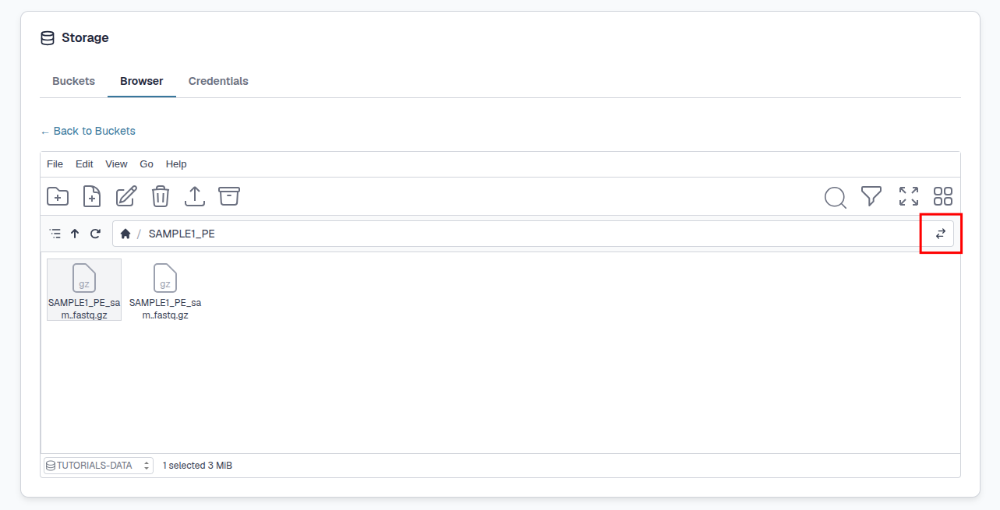
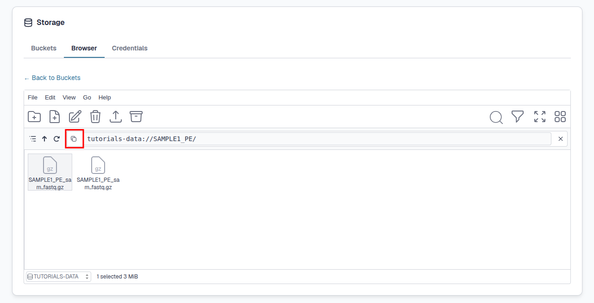

# **How to access S3 Buckets within JupyterLab environments ?**

---

Data from your S3 buckets can easily be accessed **from within your JupyterLab environments**.

For more information on what S3 buckets are and how to set up them up, see our [**S3 Buckets page**](4.2.2.s3-buckets.md).

This page will guide you through how to transfer and access data between S3 buckets and your JupyterLab environment with the following sections:

+ [**How to start ?**](4.2.4.data-transfer-jupyterlab.md#how-to-start-)
+ [**How to copy files into your team-share**](4.2.4.data-transfer-jupyterlab.md#how-to-copy-files-into-your-team-share)
+ [**Using S3 buckets with Nextflow**](4.2.4.data-transfer-jupyterlab.md#using-s3-buckets-with-nextflow)

---

## **How to start ?**

To access your S3 buckets within JupyterLab environments, you can use the command line tool [**`s3cmd`**](http://s3tools.org).

You'll find an up-to-date, stable version pre-installed in your JupyterLab environment and, more importantly, pre-configured. You can access this tool via the terminal.

For more information on how to create a JupyterLab environment and use the terminal see our [**JupyterLab environments**](../4.1.JupyterLab/4.1.1.jupyterLab-envs.md) and [**Terminal**](../4.1.JupyterLab/4.1.3.terminal.md) pages.

Once you have your terminal open you can access **`s3cmd`** as follows:

```
s3cmd
```

If you've already started using S3 buckets via Bryn, your **S3 credentials** will already have been injected into the JupyterLab environment as environment variables. Your S3 bucket storage is pre-configured for you through the `$AWS_SECRET_ACCESS_KEY` and `$AWS_ACCESS_KEY_ID` variables and the configuration file `~/.s3cfg`.

We've also pre-configured `aws cli` and `s3cmd` to use the CLIMB S3 endpoints by default. As a result, you should be able to access buckets with **no additional setup**.

!!! warning
    Do not change any of these configurations unless you are very confident with S3 and can use it without support.

You can either **copy your data/files into your team-share** or directly access the buckets from **within Nextflow pipelines**.

---

## **How to copy files into your team-share**

The following commands can be used to identify and copy data from your S3 buckets into your JupyterLab environment from the terminal:

!!! tip
    Remember to check if you are copying large files to your team-share and not your home directory !

To **list** objects or buckets use the `ls` command:

```
s3cmd ls s3://[team-name]-[bucket-name]
```

To **list** all files even within directories use the `ls` command with the `--recursive` flag:

```
s3cmd ls s3://tutorials-data/ --recursive
```

To **retrieve** a file from a bucket use the `get` command:

```
s3cmd get s3://[team-name]-[bucket-name]/File Path/for/Local_File
```

That's it, once the files are copied they are ready to be used in analysis !

Other common s3cmd commands can be seen on our [**local data transfer page**](4.2.3.data-transfer-local.md).

---

## **Using S3 buckets with Nextflow**

You can access your S3 buckets directly through [**Nextflow**](https://nextflow.io). Files within your S3 buckets can be accessed just like any other files in your home directory or Team Share Storage. Nextflow is pre-configured for the CLIMB S3 endpoints so all you need to do is use the correct paths like so:

```
s3://[team-name]-[bucket-name]/file
```

As an example, we will run the nf-core pipeline **nf-core/demo** with associated test data files already uploaded to an S3 bucket. The same process can be used for your own data files and S3 buckets.

To start we will need a file to define our samples and paths. Create a **sample sheet** called “samplesheet.csv”:

```
touch  samplesheet.csv
```

The sample sheet should include the following columns:

| Column | Description | 
| :---------- | :----------------------------------- |
| sample | Unique sample identifier |
| fastq_1 | Path to gzipped first-read FastQ file |
| fastq_2 | Path to gzipped second-read FastQ file (leave empty for single-end) |

To identify the path for the files within our S3 bucket we can use the **bryn S3 buckets section** of the dashboard and select the "Toggle path" button on the right:



You can then copy the path with the "Copy Path" button on the left:



Alternatively when interacting with a lot of files, we can use the `ls` command in the terminal:

```
s3cmd ls s3://tutorials-data/
```

This will provide the full paths to files however individual files within directories will not be shown:

```
                    DIR  s3://tutorials-data/SAMPLE1_PE/
                    DIR  s3://tutorials-data/SAMPLE2_PE/
                    DIR  s3://tutorials-data/SAMPLE3_SE/
```
To **list** all files even within directories use the `ls` command with the `--recursive` flag:

```
s3cmd ls s3://tutorials-data/ --recursive
```

This will provide the full paths to all files:

```
2026-07-14 09:48     3M  s3://tutorials-data/SAMPLE1_PE/SAMPLE1_PE_sample1_R1.fastq.gz
2026-07-14 09:48     3M  s3://tutorials-data/SAMPLE1_PE/SAMPLE1_PE_sample1_R2.fastq.gz
2026-07-14 09:48     2M  s3://tutorials-data/SAMPLE2_PE/SAMPLE2_PE_sample2_R1.fastq.gz
2026-07-14 09:48     2M  s3://tutorials-data/SAMPLE2_PE/SAMPLE2_PE_sample2_R2.fastq.gz
2026-07-14 09:48     3M  s3://tutorials-data/SAMPLE3_SE/SAMPLE3_SE_sample1_R1.fastq.gz
2026-07-14 09:48     2M  s3://tutorials-data/SAMPLE3_SE/SAMPLE3_SE_sample2_R1.fastq.gz
```

So within the team `tutorials` and a bucket named `data`, we want to add our files `SAMPLE1_PE_sample1_R1.fastq.gz` and `SAMPLE1_PE_sample1_R2.fastq.gz` to the sample sheet. 

The full path required for the forward and reverse reads are as follows:

```
s3://tutorials-data/SAMPLE1_PE/SAMPLE1_PE_sample1_R1.fastq.gz
s3://tutorials-data/SAMPLE1_PE/SAMPLE1_PE_sample1_R2.fastq.gz
```

When you add the relevant paths to your S3 bucket files to the sample sheet it should look something like this:

```
sample,fastq_1,fastq_2
SAMPLE1,s3://tutorials/data/SAMPLE1_PE/SAMPLE1_PE_sample1_R1.fastq.gz,s3://tutorials/data/SAMPLE1_PE/SAMPLE1_PE_sample1_R2.fastq.gz
SAMPLE2,s3://tutorials/data/SAMPLE2_PE/SAMPLE2_PE_sample2_R1.fastq.gz,s3://tutorials/data/SAMPLE2_PE/SAMPLE2_PE_sample2_R2.fastq.gz
SAMPLE3,s3://tutorials-data/SAMPLE3_SE/SAMPLE3_SE_sample1_R1.fastq.gz,s3://tutorials-data/SAMPLE3_SE/SAMPLE3_SE_sample2_R1.fastq.gz

```

Now you can run the pipeline using the sample sheet with the `--input` flag:

```
nextflow run nf-core/demo   -profile docker   --input samplesheet.csv   --outdir results-2
```

Most nf-core pipelines use a sample sheet to define the paths for input files, so the same approach can be used as above.

---

# **What is next ?**

Once you know to copy data to and from JupyterLab environments, you can also try using the [**jupyter notebooks**](../4.1.JupyterLab/4.1.4.jupyter-notebook.md) and [**Nextflow**](../4.1.JupyterLab/4.1.6.nextflow.md).